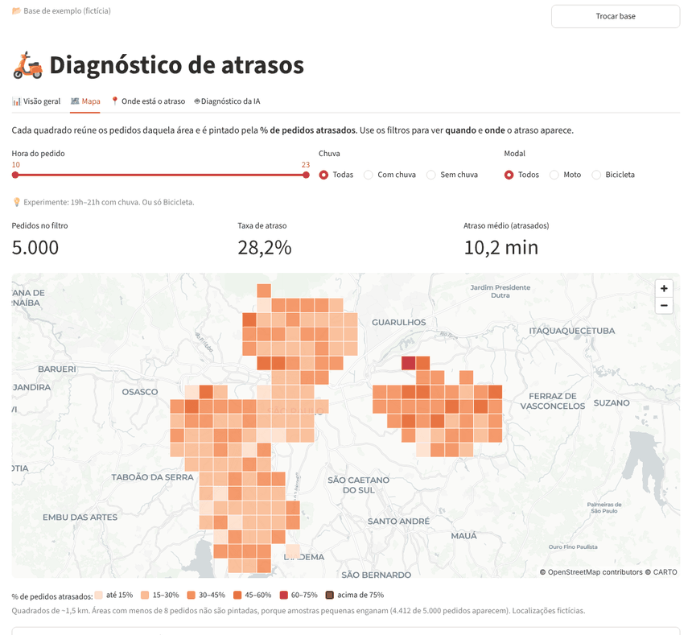
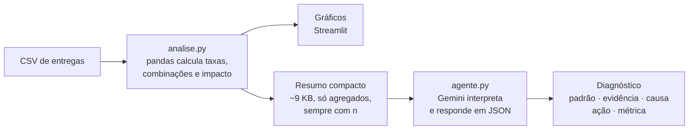

# 🛵 Agente de Análise de Atrasos em Entregas

**▶️ Teste agora: [agente-atrasos.streamlit.app](https://agente-atrasos.streamlit.app/)** (clique em "Usar base de exemplo")



Um gestor de operações envia a base de entregas, e o app mostra **onde os atrasos se concentram, por que acontecem e o que fazer**, em linguagem simples, com o diagnóstico escrito por IA **e validado**.

> Todos os dados são **fictícios**, gerados por `gerar_dados.py`. Nenhum dado real de empresa foi usado.

---

## O problema

Atraso de entrega afeta todo mundo ao mesmo tempo: o cliente espera mais, o entregador ganha menos por hora e o restaurante leva a culpa. Os dados para entender o problema normalmente existem, mas viram uma planilha de milhares de linhas que ninguém tem tempo de cruzar por região, horário, clima e modal.

## A solução

1. **Envie a base** de pedidos (ou use a base de exemplo com 5.000 pedidos).
2. **Veja onde está o atraso**: taxa de atraso por região, horário, chuva, modal, dia e restaurante, e as combinações que mais pesam.
   - **Mapa interativo de São Paulo**: a cidade dividida em quadrados pintados pela % de atraso, com filtros de hora, chuva e modal. Escolha "19h–21h com chuva" e veja a taxa ir de 28% para 81%.
3. **Receba o diagnóstico da IA**: de 3 a 5 padrões, cada um com evidência numérica, causa provável, ação sugerida e métrica para acompanhar.

## Como funciona

**A regra principal: o pandas calcula, a IA interpreta.**



- A IA **nunca vê as 5.000 linhas**, só uma tabela resumida (taxa, número de pedidos e atrasos acima do esperado por segmento). Isso deixa a resposta mais barata, mais rápida e com menos espaço para inventar.
- O prompt proíbe números que não estejam no resumo, manda ignorar grupos com menos de 50 pedidos e pede para dizer "não há padrão claro" em vez de forçar conclusão.
- A resposta vem em **JSON com formato validado** (Pydantic). Se vier quebrada, o app mostra uma mensagem amigável.
- O **impacto** de cada segmento ("atrasos acima do esperado" = atrasados − pedidos × taxa geral) também é calculado pelo pandas, para a IA ordenar os padrões sem fazer conta.

| Arquivo | Papel |
|---|---|
| `app.py` | Interface (Streamlit), incluindo o mapa (pydeck) |
| `analise.py` | Todos os cálculos (funções puras do pandas) |
| `agente.py` | Prompt, chamada ao Gemini, leitura do JSON, modelos reserva |
| `validacao.py` | Testa se a IA acha os padrões certos e se inventa números |
| `gerar_dados.py` | Gera a base fictícia (`--controle` gera a base sem padrões) |

## Como validei

Esta é a parte mais importante: **como saber se o diagnóstico da IA está certo?**

A base de exemplo foi gerada com **4 padrões plantados de propósito**, que são a "resposta certa":

| # | Padrão plantado | Taxa de atraso | Referência |
|---|---|---|---|
| 1 | Chuva no pico do jantar (19h–21h) | 81,2% | 21,2% sem chuva |
| 2 | Bicicleta acima de 4 km | 91,4% | 17,5% de moto |
| 3 | Dois restaurantes com gargalo na cozinha | ~60% | ~22% dos demais |
| 4 | Zona Leste (mais longe, menos entregadores) | 36,3% | 21,8% no Centro |

O `validacao.py` roda o agente várias vezes e faz **duas checagens automáticas**:

1. **Encontrou os padrões?** Busca palavras-chave de cada padrão plantado no diagnóstico.
2. **Inventou números?** Todo número citado na evidência e na causa precisa existir no resumo enviado à IA.

E um **teste negativo**: `gerar_dados.py --controle` gera a mesma base **sem** os padrões, para ver se a IA inventa padrão onde não existe.

### Resultados

| Configuração | Padrões plantados encontrados | Números inventados | Tempo médio |
|---|---|---|---|
| **gemini-3.6-flash, raciocínio mínimo** (configuração final, revalidado em 15/11 com o prompt atual) | **4/4 em 3 de 3 execuções** | 1 em 3 execuções: somou dois excessos (133 + 130 = 263), conta correta, mas que não estava no resumo | ~6 s |
| **Base sem padrões** (gemini-3.6-flash, modelo principal, 15/11) | 2 padrões apontados em 3 de 3 execuções, todos de bicicleta, sem inventar padrão de região, hora ou restaurante | nenhum | ~3 s |
| gemini-3.6-flash, raciocínio padrão (antes dos ajustes) | 4/4 em 1 de 3 (Zona Leste falhou em 2) | a IA recalculou contagens | ~26 s |
| gemini-3.5-flash-lite (modelo reserva) | 3/4 em 3 de 3 (não acha a Zona Leste) | nenhum | ~4 s |
| Base sem padrões (reserva lite, teste anterior) | apontou só "bicicleta em rota longa" | nenhum | ~2 s |

As saídas completas estão em [`resultados_validacao/`](./resultados_validacao).

Na base sem padrões, o modelo principal apontou "bicicleta acima de 4 km" (23,3% contra 5,3% da média, efeito real do gerador) e também "bicicleta até 4 km" (11,4%), que fica só 6,1 pontos acima da média, abaixo do limite de 8 pontos do prompt. É um deslize pequeno e honesto de registrar; o limite não foi alterado.

### O que a validação me ensinou

- **A IA estava fazendo contas.** Na primeira rodada ela citou 513, 497 e 277, números corretos mas que **não estavam no resumo**: ela calculou sozinha. Isso quebra a regra do projeto. A correção foi o pandas mandar também a quantidade de atrasados.
- **A Zona Leste é um padrão "de fronteira".** Ela fica só 8,1 pontos acima da média, bem no limite de 8 pontos do prompt, e aparecia em 1 de 3 execuções. Em vez de baixar o limite até o teste passar, passei a enviar o **impacto** já calculado (73 atrasos acima do esperado em 903 pedidos). Depois disso, apareceu em 3 de 3.
- **Mais raciocínio não foi melhor.** O nível mínimo acertou mais, respondeu em menos da metade do tempo e gastou menos cota do que o padrão.
- **No teste negativo, a IA apontou um padrão e estava certa.** Na base sem padrões, bicicleta acima de 4 km ainda atrasa 23% (contra 5% da média). Não foi plantado: é física. A bicicleta anda a ~13 km/h e o prazo prometido supõe ~17 km/h. A IA não inventou padrão, ela achou um efeito real que o próprio gerador cria.

## Exemplo de saída

Trecho de um diagnóstico real gerado pelo app sobre a base de exemplo:

> **4. Entregas destinadas à Zona Leste**
> **Evidência:** taxa de atraso de 36,3% contra a média geral de 28,2% (n = 903 pedidos; excesso de 73 atrasados). Espera média de 6,2 min e distância média de 5,8 km.
> **Causa provável:** distância média mais alta (5,8 km contra 2,5 a 4,2 km das outras regiões) e maior tempo de espera por entregador.
> **Ação sugerida:** recrutar mais entregadores posicionados na Zona Leste ou reajustar o tempo estimado de deslocamento para a região.
> **Métrica para acompanhar:** tempo médio de espera e taxa de atraso na Zona Leste.

## Pronto para uso real (plano gratuito)

O plano gratuito do Gemini permite **cerca de 20 diagnósticos por dia por modelo**. Para a demo não cair:

- **Cache compartilhado:** o mesmo resumo gera o mesmo pedido, então o diagnóstico da base de exemplo é reaproveitado por todos os visitantes por 6 h.
- **Modelos reserva com cota própria** (`gemini-3.5-flash-lite`, `gemini-3.1-flash-lite`) para bases enviadas pelo usuário. Descobri que `gemini-3.5-flash` é atendido pelo 3.6 e divide a mesma cota, então ele não serve como reserva.
- **Diagnóstico salvo:** se a cota acabar, a base de exemplo mostra uma execução real já validada (4/4), com um aviso explicando isso.

## Como usei IA para construir

- **Construção com Claude Code** (vibe coding): do zero ao app publicado em cerca de 1 dia. Eu defini o problema, a arquitetura ("pandas calcula, IA interpreta"), o desenho da validação e os critérios de pronto. A IA escreveu e testou o código comigo, e cada resultado foi conferido contra os números da base.
- **IA dentro do produto** via API do Gemini (plano gratuito do Google AI Studio), com saída estruturada em JSON.

## Limitações

- Os dados são **fictícios**. Os padrões foram plantados para permitir a validação.
- As localizações do mapa também são fictícias (sorteadas dentro de cada zona). Áreas com menos de 8 pedidos não são pintadas, para não mostrar porcentagens de amostras pequenas.
- **Correlação não é causalidade.** A "causa provável" é uma hipótese a testar, não uma conclusão.
- A IA depende da qualidade das estatísticas: se uma variável importante não estiver na base (trânsito, por exemplo), ela não aparece no diagnóstico.
- O teste negativo ainda não foi repetido no modelo principal, por causa da cota diária.

## Próximos passos

- Conectar a **dados reais em tempo quase real** (streaming de pedidos).
- Usar **previsão de chuva** para agir *antes* do pico (reforço de entregadores, prazo prometido ajustado).
- **Alerta para a cozinha** quando o tempo de preparo de um restaurante estoura o padrão.
- Medir cada ação sugerida com **teste A/B** antes de expandir.
- Cruzar o mapa com **dados abertos reais**: trânsito (CET-SP) e chuva por estação (INMET).

## Como rodar localmente

Requer Python 3.10 ou mais novo.

```bash
git clone https://github.com/lgthebaldi/agente-atrasos-entregas.git
cd agente-atrasos-entregas
python3 -m venv .venv && source .venv/bin/activate
pip install -r requirements.txt
cp .env.example .env        # coloque sua GEMINI_API_KEY (grátis em aistudio.google.com/apikey)
streamlit run app.py
```

Validação:

```bash
python validacao.py --execucoes 3                       # base com padrões
python gerar_dados.py --controle                        # cria a base sem padrões
python validacao.py --base data/entregas_controle.csv --controle
```

## Licença

[MIT](./LICENSE). Os dados são fictícios e podem ser usados livremente.
